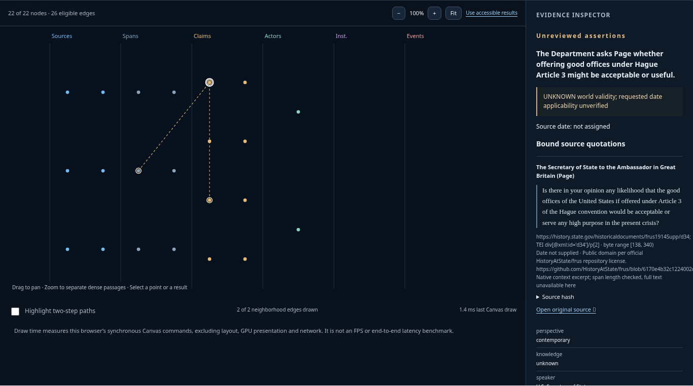

# TACITUS Workbench

Inspect a policy context without losing the passages, qualifications and omissions behind it. This repository provides a static browser viewer and a separate local workbench. The viewer opens Context JSON; the local workbench can inspect/query native ZIP capsules after a pinned Rust build and explicit opt-in. Recorded examples are labelled and never replace a failed live request.

The static viewer also has a separate **[Research selection](apps/workbench/docs/research-selection-reader.md)** mode. Open a bounded packet from the [Middle East historical atlas](https://github.com/sargonxg/Syria-political-analysis/blob/main/docs/historical-atlas.md), inspect original event fields or annual country values, and export the imported bytes unchanged. Source-kit selections and native Context JSON remain different formats; opening either performs no model generation.

[TACITUS](https://tacitus.me) is an independent project building AI data infrastructure for policy and political analysis. [PRAXIS](https://praxis.tacitus.me), its agentic workspace, is paused; sign-in remains invitation-only, AI generation and paid upgrades are unavailable, and public demonstrations remain available. This standalone local tool is separate from those services and from the [capsule core's bounded developer workflow](https://github.com/sargonxg/tacitus-political-policy-second-brain/blob/main/docs/tacitus/LOCAL_CAPSULE_RELEASE.md).

Published main includes the reviewed standalone interface from PR3 `5766d1cb3472f85d6ed702728295349e99641520` and example directories from PR1 `dd9dc217f8b839b2b00bf645b62bfb8272ee6146` and PR2 `9ed66eef932fee3b8888fcfed4ed582b0123c133`, integrated through PR4 and PR5. PR6 adds the operational architecture. Current builds pin merged core `6bbdb0764b2bc7d7b05804c79ce9b5505c3bfc95`; historical verification reports describe the checkpoints tested at the time. The existing v0.1.0 tag is unchanged.

See [operational architecture and release readiness](docs/OPERATIONAL_ARCHITECTURE.md) for the implemented flow, independent review responsibilities, release gates and proposed matched evaluation.

## Choose a workflow

| Task | Command / guide | Requirements and scope |
| --- | --- | --- |
| Inspect a recorded or exported Context JSON | `npm run build:showcase` then `npm run preview:showcase` | Node 24 and npm. Read-only browser view; local JSON imports stay in memory. No Python, Rust, server API or model account. |
| Reopen a source-kit research packet | Same static viewer; choose **Research selection** | `policy-research-selection/1`, at most 200 records / 1 MiB. Source metadata, periods, units, omissions and analyst notes are inspected separately; original imported bytes are preserved. |
| Try the complete interface with saved results | `npm run build` then `npm start` | Node 24 and npm. Loopback server on port 4317; choose **Start recorded demo**. No native execution. |
| Inspect/query a native ZIP or author bounded local text | [Pinned-core setup](#build-and-run-the-live-core) and [authoring guide](docs/LOCAL_TEXT_AUTHORING.md) | Rust 1.95.0, Python 3.11+, reviewed executable digests and explicit local opt-ins. Current native acceptance must be run in that configured environment. |
| Search a source collection or open an existing import | [Expanded collection](#prepare-the-separate-expanded-collection), [manifest importer](tools/local-import/README.md) and [collection explorer](docs/LOCAL_COLLECTION_EXPLORER.md) | Separate advanced workflows. A lexical collection is not a native capsule or reviewed claims. |

The viewer accepts `tacitus-uploaded-knowledge-context/1` exports. It does not import DIALECTICA’s different capsule formats or establish a PRAXIS attachment bridge. [Current readiness and verification](docs/READINESS_2026-11-05.md) separates executed checks from native acceptance and unrun evaluation.

The later [research-selection verification](docs/RESEARCH_SELECTION_VERIFICATION_2026-11-05.md) covers the separate source-kit reader and the current 74-test interface suite, including explicit native skips.

## Inspect a context in the browser



The **Context explorer** adds a static view of evidence, assertions, ontology, clocks, review qualifications and omissions. Open a recorded example or import an exported Context JSON in browser memory, follow exact citations, and download the original bytes. No native query or model generation runs in this viewer.

Prerequisites: Node 24, npm and Git. From a new checkout:

```sh
git clone https://github.com/sargonxg/tacitus-workbench.git
cd tacitus-workbench
export TACITUS_WORKBENCH_ROOT="$PWD"
cd "$TACITUS_WORKBENCH_ROOT/apps/workbench"
npm ci --ignore-scripts --registry=https://registry.npmjs.org
npm run typecheck
npm run build:showcase
npm run preview:showcase
```

Open `http://127.0.0.1:8767`. The recorded July 1914 context loads with its recorded label. Follow a citation, inspect the layers, export the unchanged JSON, or use **Open a context** to inspect your own export. Stop the preview with Ctrl-C. The `showcase-dist/` directory is the static artifact; `preview:showcase` is a loopback preview, not a production server. [Viewer, screenshots and optional cloud instructions](apps/workbench/docs/context-explorer.md).

## Install and run recorded mode

Use the same checkout and installed dependencies from the viewer quickstart, with the preview stopped. Node 24 and npm are enough for recorded mode. Python 3.11+ is needed for the test suite and example/collection preparation; Rust is needed for live native operations. The committed npm lockfile resolves only official registry packages. No credentials or model account are needed for recorded mode.

```sh
cd "$TACITUS_WORKBENCH_ROOT/apps/workbench"
npm run build
npm start
```

Open `http://127.0.0.1:4317`. Keep the terminal open; stop it with Ctrl-C before restarting in another mode. The workbench has been tested in a Linux cloud executor using loopback services and local-only browser previews. Public hosted deployment and authenticated multiuser operation remain unsupported; external port forwarding/access through a hosted browser is not verified. The start guide explains collection versus capsule scope and offers **Start recorded demo**, exact native sample downloads, live-core controls and local context-reuse steps. You can also select **Recorded July 1914 example** in the execution controls and load its Context. This runs no native core. The optional recorded walkthrough remains a separate teaching example.

## Build and run the live core

This implemented local path needs Rust 1.95.0 through the official rustup distribution, Python 3.11+, Git and `sha256sum`. Keep Cargo on PATH. The 5 November check did not build or execute the core because Cargo is absent; the earlier native receipts below retain their original dates and scope. From the repository root, choose a new absolute output directory:

```sh
cd "$TACITUS_WORKBENCH_ROOT"
command -v cargo
cargo +1.95.0 --version
bash scripts/build-core.sh /tmp/tacitus-build
python3 examples/july-1914/prepare_example.py
python3 examples/july-1914/.data/validation/verify_native.py --binary /tmp/tacitus-build/core-build/target/debug/examples/knowledge_capture
export TACITUS_KNOWLEDGE_CAPTURE_BIN=/tmp/tacitus-build/core-build/target/debug/examples/knowledge_capture
export TACITUS_KNOWLEDGE_CAPTURE_SHA256="$(sha256sum "$TACITUS_KNOWLEDGE_CAPTURE_BIN" | cut -d ' ' -f 1)"
export TACITUS_LOCAL_INSPECTOR=1
export TACITUS_CAPTURE_AUTHOR_BIN=/tmp/tacitus-build/core-build/target/debug/examples/local_author
export TACITUS_CAPTURE_AUTHOR_SHA256="$(sha256sum "$TACITUS_CAPTURE_AUTHOR_BIN" | cut -d ' ' -f 1)"
export TACITUS_LOCAL_AUTHORING=1
cd "$TACITUS_WORKBENCH_ROOT/apps/workbench"
npm start
```

Import `examples/july-1914/july-1914.native-v2.zip` using the native file picker, inspect, then query with the default peace question and modern checkpoint `1792328100`. Build instructions and hashes are in [CORE_INTEGRATION.md](docs/CORE_INTEGRATION.md); the [merged-pin verification](docs/MERGED_CORE_PIN_VERIFICATION.md) records the fresh compatibility run. The core preparation script creates only four capsule crates; full EdgeQuake, Docker, inference and model credentials are not needed. Preparation helpers refuse existing output directories.

## Prepare the separate expanded collection

From the repository root, with the server stopped:

```sh
cd "$TACITUS_WORKBENCH_ROOT"
python3 examples/diplomacy-1914-v2/prepare_example.py
cd examples/diplomacy-1914-v2/.data
python3 scripts/verify_corpus.py
python3 scripts/verify_extended.py
python3 collection-adapter/collection.py build corpus-index.json lexical-index
cd "$TACITUS_WORKBENCH_ROOT/apps/workbench"
npm start
```

The command above restarts the opted-in server in the same shell. **622-record lexical collection** calls the bundled Python adapter against its local 32-shard index, with a fixed 32,768-byte global output budget. Every query preserves exact source blocks, metadata, rights, warnings and omission counts, and offers exact JSON export. The browser search uses the complete modern collection without a historical filter; the adapter's CLI supports explicitly labeled calendar filters. Linux `/usr/bin/python3` is required by this local HTTP integration.

The separate `expanded-cases.native-v2.zip` can also be imported into the live native workflow. Use question `relief assurance`, known-as-of and valid-at `1792332960` to reproduce its relief fixture. The native capsule contains 46 unreviewed proposals and stays within native bounds. The baseline has 39 proposals; neither contains all 622 source records. Ten method proposals are separately represented but are not retrieved by the current core.

## Create from your own local text

[Local text authoring](docs/LOCAL_TEXT_AUTHORING.md) creates a native capsule from one bounded UTF-8 text/Markdown source, two explicit unreviewed reported-statement annotations and one user-declared relation. The live-core commands above enable the helper built by the same core script. Its required settings are `TACITUS_LOCAL_AUTHORING=1`, `TACITUS_CAPTURE_AUTHOR_BIN` and its verified `TACITUS_CAPTURE_AUTHOR_SHA256` alongside the existing live configuration. No extraction model, URL fetching or upload service is involved. Read the guide for exact quotes, rights declarations, persistence and unsupported inputs.

Stop the server or keep it in a separate terminal before proceeding to CLI tasks.

## Import a local manifest collection

The optional [Linux CLI manifest importer](tools/local-import/README.md) indexes all declared local text/Markdown sources, including source-only documents without annotations. Explicitly authored sources also produce separate bounded native capsules. It supports deterministic identities, exact bytes, atomic complete output and verified incremental artifact reuse. The tested 128-document case contains 100 authored sources and 28 source-only records; maximum 256-document and combined-near-limit cases are also verified. The [collection query command](tools/local-import/COLLECTION_QUERY.md) preserves separate native packets under one global byte budget, with explicit omissions and no semantic conflict resolution or automatic extraction.

## Compare live retrieval checkpoints

Save one successful live query as run A, change only native checkpoints and query again for run B. Inspect citation-linked selected claims/sources, qualifications, temporal disclosures and omissions. Both exact Context exports retain their original bytes. Refusals remain explicit; these modern retrieval checkpoints do not establish what an actor knew in 1914. See [comparison instructions and limits](docs/LIVE_CHECKPOINT_COMPARISON.md).

## Acceptance

Build both interfaces before running the complete default suite: its browser tests serve the built local interface and `showcase-dist/`. Python 3.11+ and a working Chromium installation are required. The default suite can pass while explicitly skipping configured native/collection tests; this is not full native acceptance.

```sh
cd "$TACITUS_WORKBENCH_ROOT/apps/workbench"
npm run typecheck
npm run build
npm run build:showcase
TACITUS_TEST_BROWSER=/usr/bin/chromium npm test
# With live + authoring variables exported and both examples prepared:
# Prepare browser collection fixtures as documented below first.
TACITUS_TEST_BROWSER=/usr/bin/chromium \
TACITUS_ACCEPTANCE=1 TACITUS_TEST_COLLECTION=1 \
TACITUS_TEST_ARCHIVE="$(git rev-parse --show-toplevel)/examples/july-1914/july-1914.native-v2.zip" npm test
node scripts/verify-inventory.mjs
```

Prepare the fresh browser collection fixtures using [the explorer acceptance commands](docs/LOCAL_COLLECTION_EXPLORER.md#reproduce-acceptance) and export `TACITUS_TEST_IMPORTED_COLLECTIONS` before full acceptance.

`TACITUS_ACCEPTANCE=1` requires these fixtures, live and authoring opt-ins, both binary/digest pairs, native archive, and collection tests; missing configuration fails instead of silently running a partial suite. Native output budgets match the pinned core range of 2,048 to 250,000 bytes.

If system Chromium is unavailable, `npx playwright install chromium` installs the matching browser; omit `TACITUS_TEST_BROWSER` to use it. Earlier preparation could not download the Playwright browser; these Linux cloud acceptance runs use preinstalled Chromium 154. Browser tests cover desktop/mobile recorded and live import/query, graph selection/filtering, exact native and lexical downloads, refusal without fallback, reset/reimport and stale export invalidation. See [integrated release-candidate audit](docs/INTEGRATED_RC_AUDIT.md) for the current verification and [release readiness](docs/RELEASE_READINESS.md) for commands and the historical PR12 pass and [historical cloud verification](docs/CLOUD_VERIFICATION.md) for the initial integration run. [npm's clean-install contract](https://docs.npmjs.com/cli/v11/commands/npm-ci/) and [Playwright launch options](https://playwright.dev/docs/api/class-browsertype#browser-type-launch-option-executable-path) describe the dependency and browser setup.

## Prepare a prompt for manual chat use

After a successful live query, or for one verified saved collection packet, [prepare a cited brief prompt](docs/MANUAL_CITED_BRIEF.md). Review its question, selected evidence, exact citation index, qualifications, unknown dates and omissions, then explicitly copy or download it for manual external chat use. This exports a prompt; it generates no answer and connects to no provider. Exact Context bytes and hashes remain available, and token counts are not inferred.

## Offline matched evaluation capability

The optional [offline harness](tools/offline-eval/README.md) freezes one identical source/annotation subset and questions, exports randomized baseline/native prompt packets, and imports external answers plus explicit human ratings. It makes no provider calls. Mechanical citation-byte checks remain separate from human support judgments; missing/refused runs stay visible. The example questions are development material, and model-answer evaluation remains unrun. No answer-quality gain is established.

## Rights and limits

[RIGHTS.md](RIGHTS.md) and [application boundaries](apps/workbench/APPLICATION_RIGHTS.md) remain in effect. Original eligible application modules retain reserved rights. Apache core/patch notices and FRUS/Gutenberg source terms are preserved; no new legal terms or application license is introduced. Lichnowsky's public-domain status is USA-specific, with Gutenberg distribution/trademark conditions retained.

The server binds loopback only and live operations require explicit opt-in. Native timestamps describe modern ingestion, not what a diplomat knew in 1914. Assertions, comparisons and metadata cautions remain unreviewed. Byte fidelity, local retrieval and historical filtering tests establish no answer-quality gains or production readiness. This workbench provides no hosting, accounts, payment, deployment or shared authorization service.

The onboarding fact fixture and downloadable ZIP copies are derived from the already shipped, checksum-verified source bundles. Regenerate them with `python3 scripts/prepare-onboarding.py`; use `--check` to verify without writing. Data tests bind displayed counts and download identities to the actual archived corpus/captures. See [onboarding verification](docs/ONBOARDING_VERIFICATION.md) for branch-specific checks.

The beginner path above is recorded demo → live sample → explicit local authoring. Batch importing and collection queries remain advanced CLI workflows. The [local collection explorer](docs/LOCAL_COLLECTION_EXPLORER.md) opens their validated output directories and optional saved receipts in the browser, with separate raw-source, authored-assertion and native-membership views. It performs no new native query. [Release readiness](docs/RELEASE_READINESS.md) separates local verification, unsupported hosting, held external integrations and unrun model evaluation.
