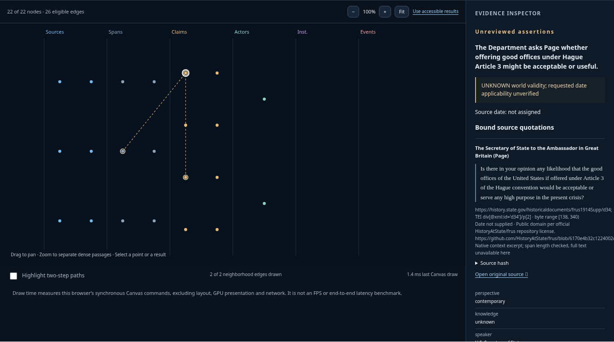

# Context explorer

A read-only browser view for the **actual exported native Context**, with an evidence graph and seven inspectable layers: purpose, exact evidence, attributed assertions, ontology/graph, time, review/limits and omissions. The inspector does not rank, rewrite, promote or review assertions. Exact JSON export preserves the original input bytes.

The **Research selection** mode is a separate [bounded source-kit reader](research-selection-reader.md). It inspects historical event and annual country records without treating them as native Context JSON. The same static build includes both modes.



[Mobile](images/context-mobile.png) · [Layer inspector](images/layers-desktop.png)

## Static viewer: local or cloud

Node 24+, from `apps/workbench`:

```sh
npm ci --ignore-scripts --registry=https://registry.npmjs.org
npm run typecheck
npm run build:showcase
npm run preview:showcase
```

Open `http://127.0.0.1:8767`. The recorded July 1914 context loads explicitly labelled as recorded. **Open a context** accepts a `tacitus-uploaded-knowledge-context/1` JSON export (maximum 2 MiB). Imports are inspected in browser memory, never sent to an API. Reloading clears them. Invalid imports clear the previous result; no example replaces the failed import.

Stop the preview with Ctrl-C. The preview command serves the built `showcase-dist/`
on loopback and refuses an occupied port. It does not require Python or expose the
local native server. To host the static files, upload `showcase-dist/` to an
appropriate static host; the preview server is for local inspection.

The data is supplied by the native core, not reconstructed from an illustration. The full ontology schema is not bundled in a Context; the inspector displays its identifier, entity kinds and annotated relationships. Modern source availability, historical document dates and world applicability remain separate. Unknowns remain unknown. An excerpt alone does not verify the complete source hash.

For Cloudflare Workers Static Assets:

```sh
npx wrangler login
npx wrangler deploy --config wrangler.showcase.jsonc
```

This publishes **only the static read-only viewer and the bundled public examples**, not the local server or Rust core. Inspect `showcase-dist/` and retain all source notices before uploading. Use Cloudflare Access on a restricted hostname when required. This configuration uses [Workers Static Assets](https://developers.cloudflare.com/workers/static-assets/); no Worker backend, database or model keys are needed. Private portfolio hosting is separate from a public case service.

## Full local workbench

The original `npm run build && npm start` flow stays loopback-only. Its live native query, authoring, ZIP import and optional collection workflows require the pinned binaries and explicit opt-ins described in the [repository guide](../../../README.md). A static viewer does not expose or replace those operations. It generates no model answer and establishes no answer-quality gain.

## Verification

```sh
npm run build
npm run build:showcase
TACITUS_TEST_BROWSER=/usr/bin/chromium node --test tests/context-layers.test.mjs tests/showcase-browser.test.mjs
```

Browser checks cover desktop/mobile layout, exact source passages, layer navigation, exact-byte download, local import, escaped text, invalid-import refusal and absence of API calls. Screenshots come from that working UI. These checks do not execute or certify a new Rust core build.

See the [5 November readiness receipt](../../../docs/READINESS_2026-11-05.md) for
the latest command results. The original [context verification](context-verification.md)
retains its 3 November scope.

Rights in [APPLICATION_RIGHTS.md](../APPLICATION_RIGHTS.md) remain unchanged. FRUS/Gutenberg notices travel in `showcase-dist/notices/`; Gutenberg public-domain status is USA-specific and other jurisdictions remain unverified.
