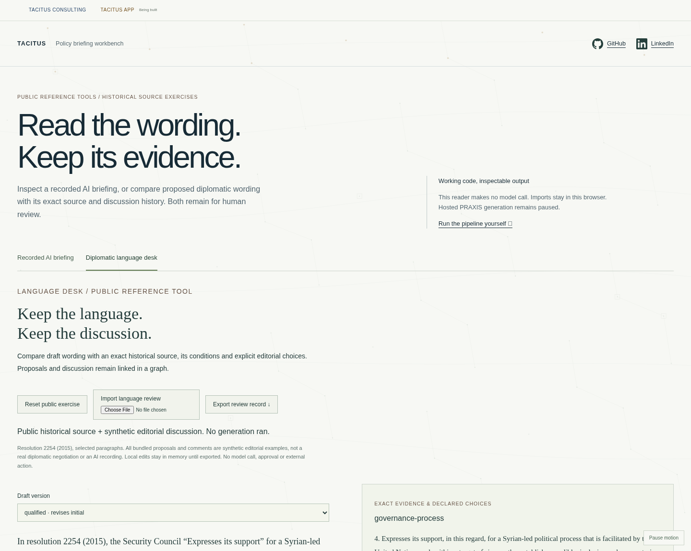

# Diplomatic language desk

The language desk extends the existing public workbench. It does not copy the private app or claim to be its production workspace. Open `/#language` in the standalone policy build or choose **Diplomatic language desk** in the policy tools.

## Clean setup

Node 24+, npm and Git. From a new checkout:

```sh
git clone https://github.com/sargonxg/tacitus-workbench.git
cd tacitus-workbench/apps/workbench
npm ci --ignore-scripts --registry=https://registry.npmjs.org
npm run typecheck
npm run build:policy
python -m http.server 8769 --bind 127.0.0.1 --directory policy-dist
```

Python is only used for this optional local static server; any equivalent static server works. Open `http://127.0.0.1:8769/#language`. No account, model key, private core or inference is needed. For the complete existing test suite, build `npm run build` and `npm run build:showcase`, install Playwright Chromium (`npx playwright install chromium`) or set `TACITUS_TEST_BROWSER` to a compatible installed Chromium, then run `npm test`. Five optional native tests may skip unless their explicit environment is configured; a skip is not native acceptance.

## Inspect one useful example

1. Select **initial**. The deliberately problematic synthetic draft repeats none of the three declared phrases. Read the whole paragraph and the two source conditions.
2. Select **qualified**. The proposed revision repeats those phrases, but remains unapproved. Literal presence is not entailment.
3. Inspect **support-language** in the graph-object selector. Its rationale is an authored review question, not an authoritative legal interpretation.
4. Follow a discussion record to its draft, then follow `concernsWording` or `cites` to the relevant choice or source-backed statement.
5. Expand **Propose wording or add a discussion note**. Enter a reason, add a revision or comment, and inspect the new links. Previous versions remain intact.
6. Export the review JSON and import it again. Edits stay in browser memory; reload does not save them. No server record, authenticated author or approval is created.

The actual source is selected normalized paragraphs from resolution 2254 (2015). All bundled drafts and discussion are explicitly synthetic editorial exercises. The separate **Recorded AI briefing** tab still displays the genuine earlier pipeline run. This desk does not generate new text.

## What the checks establish

The reader validates the 2 MiB packet bound, exact source snapshot digests and Unicode spans, source/capsule identities, quoted choices, draft citations and version digests, proposal order, history chain, derived graph and computed literal findings. Invalid imports clear the old view rather than substituting a recording. User text is rendered as text; source URLs are restricted to HTTP(S).

A locally consistent hash chain can be rewritten wholesale. It is not a signature, immutable server log or authenticated discussion. A phrase can be absent in a correct paraphrase or present in an incorrect sentence. Human review, semantic support, legal effect and current applicability remain outside these checks.

## Public-demo boundary and rights

The packet is generated by the existing [public reference compiler](https://github.com/sargonxg/TACITUS-Knowledge-Pipeline-open/blob/main/reference-pipeline/docs/diplomatic-language.md), using its attributed public source and clearly synthetic editorial history. The workbench code retains this repository's [reserved-rights boundary](../../../RIGHTS.md); the pipeline's Apache-2.0 code license does not relicense this UI or the underlying source material. No private app implementation, proprietary assets, user records, secrets or private evaluation set is bundled. No native PRAXIS attachment, production agent, paid service or generation-quality gain is claimed.



Verification, 11 November 2026: typecheck and all three builds passed; 108 tests passed with 5 optional native skips. The dedicated browser test exercises local revision/comment creation, exact export/reimport, graph inspection, invalid-import clearing and four viewport widths without external requests. A clean source checkout installed its lockfile dependencies with scripts disabled and built the static policy reader. No inference or private app code was used.
