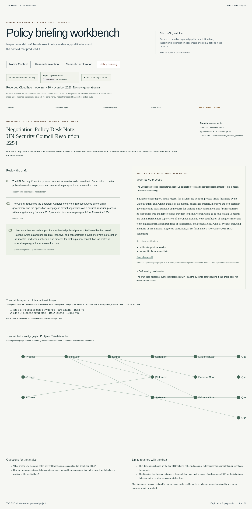

# Policy briefing reader

Open the static viewer with `?mode=workflow`, or choose **Policy briefing**. Load the recorded Syria example or import `workflow-result.json` from the [public TACITUS pipeline](https://github.com/sargonxg/TACITUS-Knowledge-Pipeline-open/tree/main/reference-pipeline).

The example contains an actual two-step Cloudflare model run from 10 November 2026: inspect selected evidence, then propose a cited historical negotiation-policy note. The reader makes no model call and never silently substitutes a recording for a failed import.



## What to inspect

- Select a draft item to read its exact supporting quotations, proposed interpretations and qualifications.
- Check literal qualification flags. The quotation can retain a condition that the model draft does not repeat; this needs review, not an automatic truth label.
- Expand the recorded agent steps, selected evidence IDs and actual provider usage.
- Inspect the pipeline graph's source, statement, evidence, entity and qualification records.
- Export the original imported bytes unchanged. A malformed import clears the previous result.

The reader checks the capsule checksum, source editions, attached citation records, qualification spans, graph endpoints and pending review state. It does not verify semantic entailment, authenticate the provider recording, assess current applicability or grant expert approval.

`tacitus-policy-workflow/1` is a separate pipeline result, not a native Context, DIALECTICA capsule or PRAXIS import contract. Hosted PRAXIS generation remains paused. Source text is untrusted reference data, never action authority.

## Run locally

From `apps/workbench`:

```sh
npm ci --ignore-scripts --registry=https://registry.npmjs.org
npm run typecheck
npm run build
npm run build:showcase
npm run preview:showcase
```

Open `http://127.0.0.1:8767/?mode=workflow`. The static output can be served without credentials; generation is performed separately through the explicitly configured pipeline provider. Source and application rights remain as documented in this repository.

## Serve only this reader

`npm run build:policy` creates the self-contained `policy-dist/` static reader and its one public recording. It includes no native ZIP downloads, historical research corpus or model credentials. Serve that directory under any fixed base path with trailing-slash routing. Source and model-receipt limitations above still apply.
