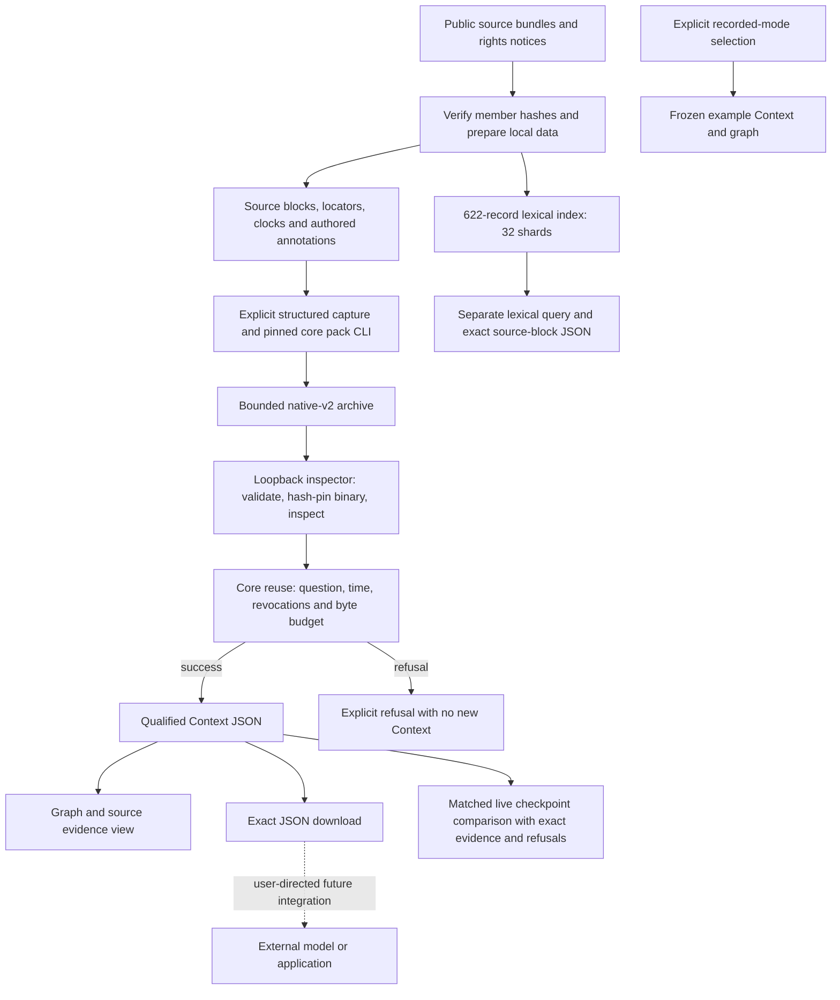

# Operational architecture and release readiness

This is a new synthesis of the public code and recorded checks at workbench main
`2b3062f8e4a4d389c2204f8d8e6f0c9dbf2e0e0f` (18 October 2026).
It is not a reconstruction of an unavailable roadmap or an assurance of production
readiness. [Run instructions](../README.md), [verification](CLOUD_VERIFICATION.md)
and [onboarding checks](ONBOARDING_VERIFICATION.md) remain the execution evidence.
Their historical branch/publication notes describe their respective runs.

## What runs today

Preparation verifies archive members and rights metadata; it does not authenticate
publisher text or adjudicate truth. The July capsule has **28 sources and 39
unreviewed claim proposals**; the expanded capsule has **31 sources and 46**.
Authored assertions, comparisons, conditions and exceptions are structured input,
not automatically approved knowledge. The CLI can propose literal line candidates
and pack explicit captures. The browser exposes only `inspect` and `reuse`, not a
semantic extraction, authoring or review-approval endpoint. See the
[July preparation and regeneration contract](../examples/july-1914/README.md) and
[expanded collection contract](../examples/diplomacy-1914-v2/README.md).

[The build helper](../scripts/build-core.sh) pins public core commit
`6bbdb0764b2bc7d7b05804c79ce9b5505c3bfc95`, which includes the reviewed source-span
fix upstream, and builds an isolated four-crate workspace with Rust 1.95.0 and a lockfile. It
does not track the latest core branch. The
[local adapter](../apps/workbench/server/local-inspector.mjs) checks the selected
executable digest, uses argument arrays without a shell, limits bodies, archives,
output, time and concurrency, removes temporary files and restricts subprocess
environment forwarding. Live access requires explicit opt-in and matching loopback
Host/Origin. These controls are local process boundaries, not shared-user access
control or a complete sandbox for hostile native code.

`reuse` accepts a question, known-as-of, valid-at, time mode, revoked-source list
and a **2,048–250,000-byte** output budget. It selects bounded source-linked
context; it does not call a model or generate a diplomatic answer. The graph is an
inspection aid, not proof of causation. Unknown validity stays unknown, and strict
time requests can refuse. Native checkpoints are modern ingestion times; the
historical clock display does not reconstruct what an actor knew in 1914.
Successful native export preserves the exact returned JSON bytes. Live reuse
requests clear the prior Context before submission; failed queries never substitute
a recording. Inspection returns manifest/count information; the graph is built
from a successful reuse Context. An inspection failure alone does not guarantee
that a prior Context export has been cleared.

The **622-record collection** (618 FRUS records and four retrospective memoir
sections) follows a separate Python lexical adapter and 32-shard index. Its HTTP
output budget is 32,768 bytes. It preserves selected source blocks, metadata,
warnings and omissions, but does not pack all 622 records into either capsule.
The browser searches the modern collection; calendar filters belong to the CLI.
Ten method proposals are separately represented and are not retrieved by current
native reuse. Recorded mode replays frozen Context and runs no core.

## Native-v2 and the legacy PRAXIS boundary

A native-v2 ZIP, a native Context JSON export and a lexical collection JSON export
are different contracts. A legacy PRAXIS attachment/import contract must not be
assumed to accept any of them. This workbench contains no verified PRAXIS bridge,
hosted native authority or automatic cross-application synchronization. No private
implementation is included or needed to state this boundary.

A future adapter needs a versioned contract, explicit supported-profile checks,
archive validation and identity, preserved source/time/qualification fields,
revocation/omission semantics, exact persistence and export tests, and rejection of
unsupported formats. Conversion must not invent review status or silently flatten
conditions. Directly downloading a ZIP is not evidence of a working external
import. The user can manually reuse exported context elsewhere; that operation is
outside this application's acceptance record.

## Four independent review responsibilities

Each responsibility needs its own evidence and decision on the exact candidate.
One passing review cannot substitute for another. Current independent technical
reviews are recorded in [integration review](TACITUS_REVIEW_REPORT.md) and
[onboarding review](ONBOARDING_REVIEW.md); they do not complete all four roles.

| Responsibility | Required decision and evidence | Current boundary |
| --- | --- | --- |
| Code and security | Review source/provenance and dependency pins; reproduce refusal, origin, digest, resource and stale-export tests; inspect release hooks. Fail on bypass, leaked credentials or silent recorded fallback. | Local technical review and tests recorded; hosted authorization and release-hook safety require separate verification. |
| Source and time accuracy | Check each claim against its exact span, speaker, edition, attribution, conditions, exceptions, dates and rights; preserve disagreement and retrospective perspective. Fail on unsupported certainty, invented knowledge dates or lost qualifications. | Hashes and exact spans checked structurally; authored semantics and historical interpretation remain unreviewed. |
| Clean-install reproducibility | Start from a clean exported candidate, locked official dependencies and pinned core/patch; prepare both datasets, build and run explicit full browser acceptance. Missing prerequisites must fail. | Two core builds and a clean exported-app installation recorded; offline npm cache and system Chromium were used. Matching bundled-browser portability remains unverified. |
| Skeptical diplomatic usefulness | Use unseen policy questions; challenge actor perspective, alternative readings, omissions and whether context supports a defensible brief or abstention. Reject fluent unsupported advice. | Pending; no measured answer-quality or operational decision benefit established. |

## Concrete release gates

A skipped or absent check is unresolved, not a pass. These are release decisions,
not new claims that all gates have been executed for every commit.

| Gate | Pass / fail rule | Evidence or status |
| --- | --- | --- |
| Candidate identity | Exact source commit, core/patch pins and archive hashes recorded; notices retained. Fail on unexplained content or rights changes. | Public pins and notices in [core integration](CORE_INTEGRATION.md), [rights](../RIGHTS.md) and source manifests. |
| Install and application | Locked clean install, typecheck, build and default suite succeed. Full acceptance must explicitly enable native and collection prerequisites and have zero skips. | Prior main-source default and full suites: 8/8 each; see onboarding verification. A default-only pass cannot establish live operation. |
| Native fidelity | All ten frozen fixture outputs match exactly; deterministic repack, budget bounds, tamper/revocation/strict-time refusals succeed. Fail on byte drift without review or export after a refused reuse query. | Four July and six expanded fixtures recorded; these are structural regressions, not unseen evaluation questions. |
| Collection fidelity | 622 records / 32 shards, exact adapter/browser response and export, global cap and omission counts agree. Fail if omission-only output is presented as an answer. | Recorded integrated browser and corpus checks; separate from native capsule scope. |
| Browser boundary | Desktop/mobile import, graph, query, reset, error and stale-download behavior pass. Fail on page errors, silent fallback or stale export. | System Chromium acceptance recorded; matching Playwright browser download was blocked. No full accessibility audit claimed. |
| Source and usefulness | Independent source/time review passes and the held-out study below meets predeclared criteria. Fail on unsupported attribution/time/citation or unresolved critical defects. | Pending. Current proposals must retain unreviewed labels. |
| Publication and hosting | Current permitted protections/checks/reviews and hooks can be inspected; no unmet requirement or excluded deployment/security/cost effect. Fail closed on inaccessible evidence. | Must be checked at publication; mergeability alone is insufficient. Hosting, accounts and payments are pending. |

## Proposed matched evaluation — not yet run

Freeze a protocol before collecting answers. Start with the **same exact source
subset** represented by one capsule, with identical source versions, rights and
source identifiers in both arms. Do not compare a 622-record baseline with a
28-source capsule and attribute the difference to representation. Distinguish a
source-only experiment from an annotation-controlled experiment: if a capsule
includes authored annotations, give the baseline those same annotations in the
controlled arm. Freeze extraction/retrieval settings and report this distinction.

Use one frozen model/version, prompt, decoding settings, tokenizer, output limit
and context-token ceiling. Count metadata and annotations inside that ceiling;
record selected and omitted evidence and actual token use. Keep the task prompt
identical apart from necessary representation instructions. Measure selection and
packing before generation as well as generation itself; a Context byte cap is not
a model token budget. Do not force-fill shorter contexts with extra evidence.

An independent diplomatic reviewer prepares held-out questions and a source-based
rubric before tuning. Include cross-source disagreement, attribution, conditional
assurances, exceptions, retrospective accounts, temporal limits, unanswerable
questions and retrieval distractors. Exclude the ten frozen fixtures and their
paraphrases. Keep test questions unavailable to annotation authors and tuning;
record unavoidable prior exposure. Use a development split and lock the final
test split before changes, rather than claiming unseen data from familiar demos.

Blind and randomize paired answers for review. Score source support, exact
citation/locator resolution, speaker and modality, conditions/exceptions, temporal
honesty, omission disclosure, justified abstention and diplomatic usefulness
separately. Unsupported certainty, fabricated citations and false verified-date
claims are critical failures; successful structural export cannot offset them.
Predeclare the critical-failure threshold, usefulness rubric and minimum sample
before the run; preserve every failure rather than choosing favorable examples.

Report paired question-level results and reviewer disagreements, sample sizes,
uncertainty intervals and effect sizes. Use paired resampling with source/case
clusters where questions share evidence; a small convenience set cannot justify
population-wide claims. Repeat any stochastic generation under a fixed schedule,
report variation, and separate reviewer uncertainty from model variation. Record
end-to-end and component latency, tokens and actual monetary cost; separate one-off
authoring/indexing cost from per-query and explicitly stated amortized costs.
No paid/model calls or this study have been executed as part of this document.

## Implemented and pending

**Implemented locally:** pinned capsule build; verified source bundles; explicit
recorded/live separation; native import/inspection and graph; bounded deterministic
reuse and exact exports; separate lexical collection search; visible uncertainty,
source notices and unreviewed status; guided onboarding, [live checkpoint comparison](LIVE_CHECKPOINT_COMPARISON.md) and structural regressions.

**Pending acceptance or implementation:** independent semantic/historical approval,
matched model evaluation, automatic semantic extraction and approval workflow,
retrieval of the separate method proposals, hosted identity/shared permissions,
production persistence and operations, verified native/legacy application bridge,
full accessibility/portability coverage and any deployment. Existing
[reserved application rights](../apps/workbench/APPLICATION_RIGHTS.md), Apache core
notices and source-data terms continue unchanged. No new legal terms are introduced.
