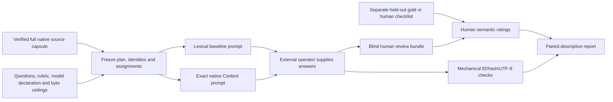

# Offline matched evaluation

This Linux/Python CLI freezes a matched retrieval/representation experiment. It
exports prompt files, accepts externally produced answers and explicit human
ratings, and reports every paired question. It never calls a provider, installs a
model, handles keys, generates answers or infers costs. Creating this capability
establishes no model-quality gain. The separate model-answer study is still unrun.

## What is matched

Both arms start from **one identical, hash-verified native-v2 capsule**, including
its complete embedded source bytes and the same authored assertions, qualifiers,
evidence bindings, entities, relationships and observation/knowledge declarations.
The baseline is not derived from native retrieval's selected citations. The
622-record source collection is not silently substituted for a bounded capsule.

The baseline ranks fixed UTF-8 source blocks and atomic qualified annotation/node/
relationship closures by unique query-word overlap in content fields. It scores
source text/title/author, assertion semantics and qualifications, entity labels and
relationship rationale/kind—not IDs, hashes, offsets or JSON field names. Ties use
stable unit IDs. Whole closures are packed greedily; unique assertion/citation/
entity/relationship maps avoid repeated serialization of the same annotation.
Units that do not fit the evidence budget are skipped whole; exceeding the separate expanded-candidate safety bounds aborts freeze. All information was available to both
retrievers; which information is selected can differ. This is one pinned lexical
baseline, not a claim about all RAG systems or an optimized relevance benchmark.

The capsule arm calls the same pinned `knowledge_capture reuse` contract used by
the workbench and preserves its exact raw JSON bytes inside the prompt. The
instructions, question and response instructions are identical in both arms.
**The full UTF-8 prompt** counts against the same predeclared byte ceiling,
including all evidence metadata, instructions and final newlines. Evidence
ceilings are also equal and stay within native 2,048–250,000-byte bounds. Actual
prompt/evidence bytes and SHA-256 identities are recorded. No padding or extra
source fill makes shorter output appear equivalent. Equal byte ceilings do not
establish equal token use; native and lexical formatting overhead is counted.

The estimand is this combined annotation-controlled retrieval/representation
protocol on these frozen sources/questions. It is not unannotated RAG versus
TACITUS, a model-only comparison or a causal estimate isolating graph structure.

## Scope and experimental controls

- One native-v2 capsule: at most 32 sources, 256 assertions, 256 nodes, 512 links;
  ZIP/expanded data at most 8 MiB, 64 entries and 2 MiB per entry. No methods,
  reviews or unrecognized artifacts. Source metadata/rights are preserved.
- Initial matched profile requires unrestricted, unwithdrawn, redistributable
  sources with unknown publication/world-validity intervals, unknown observations
  and empty knowledge declarations. Finite capsule expiry and declared node event
  times are unsupported. Known-as-of must cover the entire archive, assertion and
  graph availability. This intentionally narrow shared eligibility profile
  prevents one arm from seeing evidence unavailable to the other.
- Disclose-unknown mode supplies qualified evidence. Strict unknown-validity or
  mandatory-budget refusals remain explicit. A crash, unknown native exit,
  timeout or invalid native result aborts freeze, rather than pretending to be a
  policy refusal. No successful partial experiment is published on failure.
- At most 64 declared questions and 16 in the selected split. Question IDs,
  normalized exact texts and cross-split paraphrase groups must be distinct.
  A previously exposed question cannot be declared held out. Group assignment,
  novelty and exposure are human declarations; disguised paraphrases cannot be
  detected automatically. Public demos/fixtures and their paraphrases belong to
  development. This is **question-held-out on shared sources**, never a source-
  or domain-held-out claim.
- Plan schemas reject gold/reference-answer fields. No exporter accepts a gold
  path or reads ratings/answers. Keep held-out gold/checklists in separate human
  review storage; never put them into sources, questions or task instructions.
  The no-gold attestation is not automatic detection of semantic leakage. Freeze
  groups, rubric, model revision/settings/tokenizer identity and budgets before
  looking at external answers or tuning retrieval.
- Arm labels A/B and run order are randomized once. The seed and arm key are in
  `private/`; the root manifest contains only the seed hash. Do not rerandomize
  after seeing answers/ratings. The formats may reveal the arm: this is partial
  blinding, not guaranteed concealment. Share only the intended blind bundle and
  record actual reviewer exposure.

## 1. Install and freeze

Use the [root clean-clone/core build](../../README.md). No new npm/Python packages
are required. Core remains pinned to
`6bbdb0764b2bc7d7b05804c79ce9b5505c3bfc95`; the user-selected executable SHA is
verified on a private copy. A hash and declared source pin are integrity records,
not independent attestation of how a binary was built. Reuse a reviewed build.

From the repository root, copy `example-plan.json` to a new local plan. Its July
questions are explicitly **development** material. Replace all four
`REPLACE_WITH_...` model/tokenizer fields with the exact external model revision
and tokenizer identity you intend to use; placeholders refuse. Set decoding,
output-token ceiling and optional input-token ceiling before freezing. A null
input ceiling means a byte-matched experiment, with no matched-token claim.
For actual external answers retain `response_origin: external_model_output`.
`synthetic_test_fixture` is reserved for reproducible harness tests, and remains
visibly labeled in reports. Origin/model declarations are not provider-authenticated.

```sh
cd "$TACITUS_WORKBENCH_ROOT"
export TACITUS_EVAL_RUN="$(mktemp -d /tmp/tacitus-eval.XXXXXX)"
cp tools/offline-eval/example-plan.json "$TACITUS_EVAL_RUN/plan.json"
# Edit "$TACITUS_EVAL_RUN/plan.json" now: model/version/tokenizer, questions and budgets.
export TACITUS_KNOWLEDGE_CAPTURE_BIN=/tmp/tacitus-build/core-build/target/debug/examples/knowledge_capture
export TACITUS_KNOWLEDGE_CAPTURE_SHA256="$(sha256sum "$TACITUS_KNOWLEDGE_CAPTURE_BIN" | cut -d ' ' -f 1)"
python3 tools/offline-eval/evaluate.py freeze \
  --archive examples/july-1914/july-1914.native-v2.zip \
  --archive-sha256 c7268bef3b19ff9b93458a64e476dd52df1c76f074e77fe149d2983268a66e5f \
  --plan "$TACITUS_EVAL_RUN/plan.json" \
  --core "$TACITUS_KNOWLEDGE_CAPTURE_BIN" \
  --core-sha256 "$TACITUS_KNOWLEDGE_CAPTURE_SHA256" \
  --output "$TACITUS_EVAL_RUN/experiment" > "$TACITUS_EVAL_RUN/freeze-receipt.json"
export TACITUS_EVAL_MANIFEST_SHA256="$(python3 -c 'import json,sys; print(json.load(open(sys.argv[1]))["manifest_sha256"])' "$TACITUS_EVAL_RUN/freeze-receipt.json")"
```

Use a new output directory; parent directories must exist and be real directories.
Existing experiments are never overwritten. Preserve the receipt's full manifest
hash with the reviewed experiment. Recalculating a hash from an untrusted
replacement does not authenticate that replacement.



`blind/run-order.json` lists randomized packet IDs. Ready packets have complete
`blind/prompts/ID.txt` plus metadata in `blind/packets/ID.json`. Refused retrieval
packets have no prompt. `private/` contains the full source archive/catalog, rubric,
original plan, exact raw evidence, seed and arm mapping. Do not share that tree
with blind reviewers. Store the frozen experiment as immutable local material;
private permissions are not encryption. Source and application rights still apply.

## 2. Import external answers

Generate a template bound to the full experiment identity:

```sh
python3 tools/offline-eval/evaluate.py answer-template \
  --experiment "$TACITUS_EVAL_RUN/experiment" --experiment-sha256 "$TACITUS_EVAL_MANIFEST_SHA256" \
  --output "$TACITUS_EVAL_RUN/answer-template"
```

This creates `answers.json` with **missing** entries and unknown measurements.
Copy it before editing. Obtain answers outside this tool using the exact prompt
files in the frozen run order and the declared model/settings. This tool does not
initiate those runs. Preserve all refusals/errors rather than cherry-picking
answers. A record binds packet/question ID, exact prompt SHA, full model/version/
settings/tokenizer declaration and origin to the frozen plan. Duplicate, extra or
mismatched records refuse import. An omitted submission is missing, never success.

For an answered record set `status: answered`, `answer` to the external answer,
`reason: null`, and declare citations separately:

```json
{"source":"SOURCE_ID@VERSION","text_hash":"EXACT_SOURCE_TEXT_SHA256","start":0,"end":10,"quote":"EXACT_UTF8_SPAN"}
```

Offsets refer to canonical source UTF-8 bytes, not character indexes or prompt
positions. For `refused`, `error` or `missing`, keep `answer: null`, `citations: []`
and give a bounded explicit `reason`. A substantive evidence-based abstention can
also be an answered response; a separate model refusal is rated using its reason.
No answer may be supplied for a refused retrieval.

Measurements default to `origin: unknown` with `provenance` and all values null.
For any supplied value use `origin: user_supplied_measured`, name its measurement
provenance and provide only actual measured `latency_ms`, `input_tokens`,
`output_tokens` and/or `cost: {amount, currency}`. Zero measured output tokens or
zero cost is allowed; unknown is not zero. Counts/prices/latency are never inferred
from prompt bytes, answer length or advertised pricing. Use exact full-prompt
measurements with the pinned tokenizer if claiming token compliance. Known token-
ceiling violations remain explicit and are excluded from paired score summaries;
unknown counts remain unknown and prevent a verified token-budget claim.

## 3. Human review before unblinding

```sh
python3 tools/offline-eval/evaluate.py review \
  --experiment "$TACITUS_EVAL_RUN/experiment" --experiment-sha256 "$TACITUS_EVAL_MANIFEST_SHA256" \
  --answers /absolute/external-answers.json --output "$TACITUS_EVAL_RUN/human-review"
```

The output contains `blind-answers.json`, canonical full `sources.json`, the frozen
rubric and an empty `ratings.json`. It withholds arm mapping, prompts, model names,
retrieval receipts and machine-check results from that review bundle. Reviewers
may consult separate held-out gold here, not during retrieval. Missing answers
remain visible. The frozen rubric uses four ordinal 0–4 dimensions: support,
qualifications, uncertainty and task response, plus an explicit critical-failure
flag. All are human judgments; none are generated by the harness.

Add one record per reviewer/packet to `ratings` using the answer SHA provided by
`blind-answers.json`. Multiple reviewers' judgments and disagreements remain
separate. For example (replace every illustrative value with an actual review):

```json
{
  "packet_id":"FROZEN_PACKET_ID",
  "answer_sha256":"FROZEN_ANSWER_RECORD_SHA256",
  "reviewer":"DECLARED_REVIEWER_ID",
  "scores":{"support":2,"qualifications":2,"uncertainty":2,"task_response":2},
  "critical_failure":false,
  "notes":"Human review explanation with source support and limitations.",
  "source_refs":["SOURCE_ID@VERSION"],
  "review_conditions":{
    "arm_key_seen":false,
    "mechanical_checks_seen":false,
    "prior_case_exposure":"Describe actual prior exposure."
  }
}
```

Both answered responses and explicit model refusals may be rated. Missing/error
runs cannot be rated. Rating identity must bind the exact imported answer record
and frozen experiment/rubric; changing an answer or model/measurement record
requires a new matching review. Reviewer identities, exposure and ratings remain
unverified declarations. Report actual arm-key/machine-check exposure truthfully.

## 4. Summarize every question

```sh
python3 tools/offline-eval/evaluate.py summarize \
  --experiment "$TACITUS_EVAL_RUN/experiment" --experiment-sha256 "$TACITUS_EVAL_MANIFEST_SHA256" \
  --answers /absolute/external-answers.json \
  --ratings /absolute/completed-human-ratings.json --output "$TACITUS_EVAL_RUN/report"
```

The report unblinds the arms. Every frozen question includes both run statuses,
refusal/error reasons, prompt bytes, retrieval receipts, immutable answer hashes,
measurements and individual human ratings. Missing ratings receive no imputed
score. Paired descriptive ordinal-score differences use the **same reviewer** on
both answered/refused model runs, then average within question; multiple reviewers
do not multiply a question's weight. Missing/error/retrieval-refused or known
budget-violating pairs remain in rows/denominators and receive no paired score.
Reports show total frozen questions, run-status counts, eligible question counts,
question-level regressions, critical-failure flags and individual disagreement.

Citation mechanics separately check source ID@version, source hash, UTF-8 bounds,
exact quote bytes and coverage by the union of evidence spans actually supplied
in that arm. Adjacent supplied spans can cover a quote; real gaps cannot. A valid
quote from an unsupplied source span fails prompt-presence checking. No declared
citations is `not_applicable_no_citations`, not an automatic pass. **None of these
checks score entailment, complete citation coverage of prose, speaker correctness,
truth, hallucination or historical applicability.** Those require human review;
mechanically valid citations can accompany a wholly unsupported answer.

Baseline `unselected_candidate_units` includes unused/redundant closures whose
actual assertions may be retained elsewhere. It is not a missing-evidence count
and must not be compared numerically with native omitted assertions. Both keep
separate selected-assertion counts and original receipts. Different serialized
representations may use different fractions of the same ceiling.

Means of small ordinal samples are descriptive summaries, not statistical effects
or superiority evidence. Development fixtures, known cases and one source subset
support no unseen-task, source/domain, production or model-quality generalization.
A credible study still needs independently prepared questions/gold, justified
sample size, blinded review conditions, exposure control and a predeclared
analysis. Frozen plan and report-processing implementation identities are recorded
separately. No external answers/measurements are provider-authenticated.

## Reproducible tests and local safety

```sh
cd "$TACITUS_WORKBENCH_ROOT"
TACITUS_KNOWLEDGE_CAPTURE_BIN=/tmp/tacitus-build/core-build/target/debug/examples/knowledge_capture \
  python3 -W error::ResourceWarning -m unittest discover -s tools/offline-eval/tests -v
```

Set the real core path to execute native acceptance; otherwise those tests are
explicitly skipped, not proof of native operation. The fixtures invent answers
and reviewer scores only inside tests and label them **synthetic test fixtures**.
No such answer is represented as model output. Tests include exact native output,
full source/annotation availability, budgets, mechanical false positives/negatives,
splits/gold fields, unknown metrics, human abstention/regressions/disagreement,
missing/error/refused cases, metadata/tamper/path refusal, resource bounds and
actual SIGTERM cleanup.

Inputs use existing bounded strict-JSON, FD-relative no-symlink and empty-environment
subprocess helpers. Freeze verifies and privately copies the selected executable
and ZIP, inspects with the core before building candidates, limits expanded
candidate material (2 MiB per unit/16 MiB total), and has a 120-second operation
ceiling plus 10-second child deadlines. Frozen outputs are at most 64 MiB/1024
files. New outputs stage privately and publish with Linux atomic no-replace;
ordinary error/SIGINT/SIGTERM cleans stages. Crash/SIGKILL/power-loss durability,
non-Linux behavior, encryption, shared authorization and hostile executable
sandboxing are not established. No collection or answer file supplies an executable.

Existing [rights](../../RIGHTS.md), reserved application-module boundaries, Apache
core notices and source-data terms remain unchanged. No commercial license or new
legal terms are introduced. PRAXIS/Foundry deployment holds and unsupported hosting
remain in force. See [verification](VERIFICATION.md) for actual commands/results.
